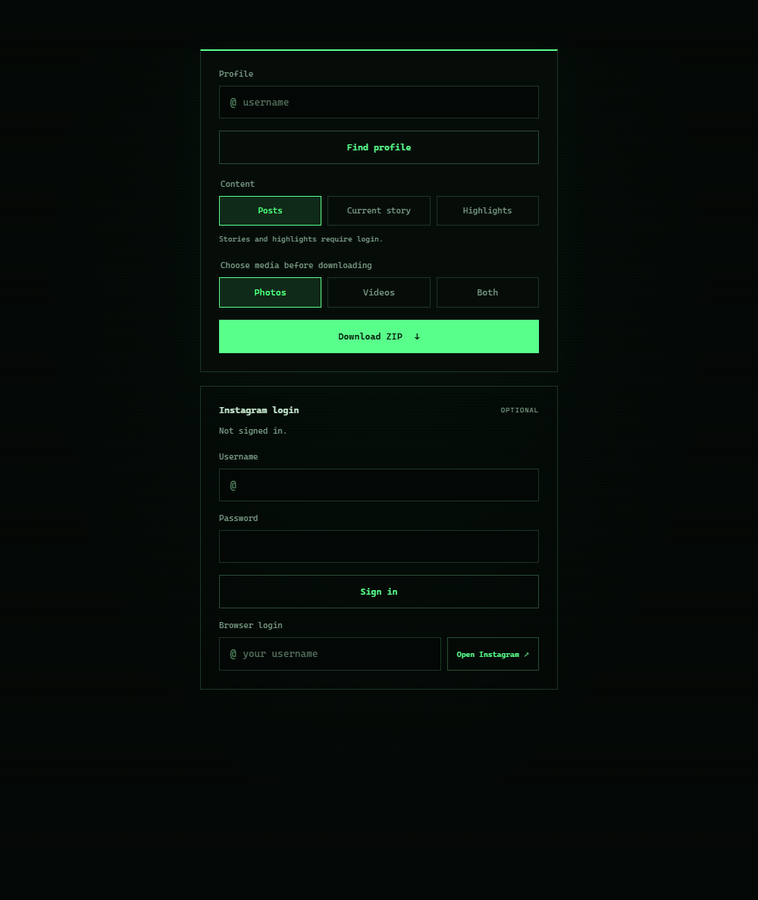

# Insta Archive

Local Instagram media downloader. Select **Posts**, **Current story** and/or **Highlights**, then choose **Photos**, **Videos** or **Both**. Selected content is bundled into one ZIP, organized by source.



## Installation on Windows

### Requirements

- Windows and Python 3.10 or newer.
- An internet connection to install dependencies and download media, plus enough free disk space.
- Microsoft Edge for browser login through **Open Instagram**.

### Quick installation

1. Download the project folder and extract it if provided as a ZIP. Keep `app.py`, `requirements.txt` and `start.bat` in the same folder.
2. If Python is missing, install it from [python.org](https://www.python.org/downloads/windows/). Enable **Add python.exe to PATH** if offered, then open a new terminal.
3. Double-click **`start.bat`**. It creates the `.venv` virtual environment if needed, installs packages from `requirements.txt` and starts the app and browser.
4. Wait for the startup message. The interface is available at **http://127.0.0.1:5000**. Keep the console window open while using the app.

For later launches, double-click `start.bat` again. If Windows hides file extensions, the file may appear as **start**.

To check Python, open the project folder in File Explorer, type `powershell` in the address bar and press **Enter**. Run:

```powershell
python --version
```

The reported version must be Python 3.10 or newer. If Python is not found, check your installation and PATH, then open a new PowerShell window.

### Manual installation with PowerShell

Open PowerShell in the extracted project folder and run these commands one at a time:

```powershell
python -m venv .venv
.\.venv\Scripts\python.exe -m pip install -r requirements.txt
.\.venv\Scripts\python.exe app.py --open-browser
```

You do not need to activate the virtual environment. If the browser does not open automatically, visit **http://127.0.0.1:5000**.

If port 5000 is already in use, use the existing app instance or start on another port:

```powershell
.\.venv\Scripts\python.exe app.py --port 5001 --open-browser
```

The interface will then be available at **http://127.0.0.1:5001**.

## Download media

1. Enter the target Instagram username, such as `username` or `@username`, without a profile URL.
2. Click **Find profile** to preview the profile picture when available.
3. Select **Posts**, **Current story**, **Highlights**, or any combination. Sign in first for stories and highlights.
4. Choose **Photos**, **Videos** or **Both**. This filter applies to every selected source, including mixed carousels.
5. Click **Download ZIP**. The archive downloads automatically after completion. Use **Save ZIP** if the automatic download does not start or you need another copy.
6. Use **Cancel Download** to stop a running job and remove incomplete files. An in-flight request may finish before cancellation takes effect.

One job runs at a time. Content and media selections are locked while a download is running and become available again when it finishes or is cancelled.

Archives are named `username_photos.zip`, `username_videos.zip` or `username_media.zip`. Your browser normally saves them in its Downloads folder or asks you to choose a location. To extract an archive in Windows, right-click it and select **Extract All**.

Inside the archive, media is grouped under the username:

```text
username/
  posts/
    Photos/
    Videos/
  stories/
    Photos/
    Videos/
  highlights/
    Travel/
      Photos/
      Videos/
    Summer/
      Photos/
      Videos/
```

Each content folder, including each highlight, separates images into `Photos/` and videos into `Videos/`. Only folders containing downloaded media are included.

Highlight folders use the highlight title. Invalid filename characters are replaced, long names are shortened and duplicate names receive a numbered suffix. Empty titles use `Untitled`.

Only currently accessible stories and saved highlights are available. For private profiles, your signed-in account must already have access.

## Sign in to Instagram

Sign in through the interface; no terminal commands or environment variables are needed. Public posts can be attempted without login. Stories and highlights require a signed-in account.

### Browser login

Use this option if direct login fails or Instagram requires additional confirmation.

1. Open the app at **http://127.0.0.1:5000**, or the port you selected.
2. Under **Browser login**, enter the username of your own Instagram account.
3. Click **Open Instagram**.
4. Sign in directly on Instagram in the separate Edge window. Complete any two-factor, cookie or security prompts there.
5. Leave the window open until the app imports the session. It checks that the signed-in account matches the username you entered, then closes the separate window automatically.
6. When **Signed in as @yourname** appears, start the target profile download.

Browser login uses a new, separate browser profile without reading your existing browser profiles. You enter your password and verification code directly on Instagram. Only the resulting Instagram session is imported into the local app; no session file is created. Use **Cancel login** to stop the login process. It expires after ten minutes.

If the window does not open, check that Microsoft Edge is installed and run `start.bat` again to install any missing dependencies.

### Direct login in the app

1. In **Instagram login**, enter the username and password of your own Instagram account.
2. Click **Sign in** and wait for Instagram to respond.
3. If prompted for a **Verification code**, enter the code from your authenticator or Instagram SMS and click **Verify**. You can retry an incorrect code. The pending login expires after ten minutes; submitting a code after expiry returns you to the login form.
4. When **Signed in as @yourname** appears, enter the target profile and start the download. Your login account and target profile can be different.
5. Use **Sign out** to remove the session, or **Cancel login** to cancel a pending verification step.

The password is used to sign in to Instagram and is not saved. The session remains in the local app's memory. Reloading the page keeps you signed in while the app is running; stopping or restarting the app requires signing in again. Browser tabs share the same app login.

Instagram may require additional confirmation in its app or website. Complete those prompts there and retry. Signing in does not guarantee that Instagram will allow a download.

Signing out does not stop an existing download: it continues using the session captured when it started. Use **Cancel Download** to stop that job.

## Stop the app

1. Wait for your download to finish and save the ZIP, or cancel the running job.
2. Focus the app's console window and press **Ctrl+C**. Confirm any Windows prompt if shown.
3. Close the browser tab when finished.

Closing the browser tab alone does not stop the app.

## Troubleshooting

| Problem | What to do |
| --- | --- |
| Python is not found, or the Microsoft Store opens. | Check your Python installation and PATH, then open a new PowerShell window. |
| Package installation fails. | Check your internet connection and the console error message, then run `start.bat` again. |
| The app page cannot be reached. | Keep the console open, wait for `Instagram Downloader: http://127.0.0.1:5000`, then reload the page. Use your selected port if different. |
| Port 5000 is already in use. | Use the app already running, stop that instance, or choose another port as shown above. |
| Instagram requires login. | Sign in under **Instagram login** and start the download again. Stories and highlights always require login. |
| Username, password or verification code is incorrect. | Check your input. Re-enter your password after a failed login. |
| Session status is unavailable. | Check that the app is running and click **Refresh session**. Retry login if necessary. |
| The target profile is private. | The signed-in account must already have access to that profile. |
| Instagram blocks or limits requests. | Wait and check security prompts directly on Instagram. Login does not guarantee access. |
| Instagram returns HTTP 401. | Try **Open Instagram** to sign in through the browser. If that session is also rejected, wait before retrying. |
| Instagram returns HTTP 403. | Check security confirmations directly on Instagram. The app does not bypass access restrictions. |
| Instagram returns HTTP 429. | Wait before retrying and avoid starting additional requests in parallel. |
| Instagram returns unexpected API data. | Its API may have changed. Check your Instaloader installation; `requirements.txt` specifies the supported dependency range. |
| Download status cannot be loaded. | Check that the app is running and click **Retry status**. The job may still be running in the background. |
| The ZIP does not download automatically. | Click **Save ZIP** after completion and check your browser's download list. |
| No matching media is available. | Check the username, selected sources and media filter. The profile may have no accessible content matching your choices. |
| The profile picture does not appear. | The picture may be unavailable. You can still try downloading the profile's media. |

## Storage and limitations

- The app runs locally on `127.0.0.1`, using port 5000 by default.
- Archives are also stored in the project folder at `downloads/<random ID>/photos.zip`. This internal filename is used for every media selection; the browser download uses the selected media suffix.
- Individual media files are removed after being added to the ZIP.
- Finished jobs older than one hour are removed from the running app when a new job starts, along with their local archives. Save completed ZIPs promptly through the browser.
- After restarting the app, previous jobs are no longer available in the interface. Any remaining archives stay in `downloads`. You can manually clear that folder while the app is stopped if you no longer need them.
- Failed or cancelled downloads have their incomplete archives removed and are not offered as completed ZIPs.
- Instagram can restrict access or change its APIs, so a complete download is not guaranteed for every profile. The app does not bypass access restrictions.

Only save content you have permission to download. Media retrieval uses [Instaloader](https://instaloader.github.io/as-module.html).

## Tests

These steps are optional for normal use. Open PowerShell in the project folder after installing the app.

### Application tests

```powershell
.\.venv\Scripts\python.exe -m unittest discover -s tests -v
```

Tests cover ZIP contents, photo and video filters, source combinations, highlight folder naming, profile previews, cancellation, private profiles, login, two-factor verification, logout, error handling and input validation. They also start the actual local Waitress server and check its HTTP responses. Instagram is simulated: no credentials or real Instagram requests are needed.

### Browser tests

Install Microsoft Edge and the test dependencies, then run:

```powershell
.\.venv\Scripts\python.exe -m pip install -r requirements-dev.txt
.\.venv\Scripts\python.exe -m unittest discover -s tests -p browser_checks.py -v
```

Browser tests run Edge without a visible window and operate the actual interface through a temporary local HTTP server. They cover login errors and retries, verification codes, session expiry, logout, ZIP downloads, cancellation, media and source selections, profile previews, recovery after server restarts, blocked browser storage and network failures. They also check for horizontal overflow at a viewport width of 375 pixels. Only Instagram is simulated.

Browser tests run separately so application tests do not require a browser installation. Test browsers and servers are stopped afterward, and temporary archives are removed.

## Browser login background

The app imports an Instagram browser session as a fallback for direct login problems. Before accepting the session, it checks for session and CSRF cookies. This does not guarantee that Instagram will allow subsequent media requests.

Further reading: [Instaloader login troubleshooting](https://instaloader.github.io/troubleshooting.html#login-error) and an [issue about invalid session cookies](https://github.com/instaloader/instaloader/issues/2487).
